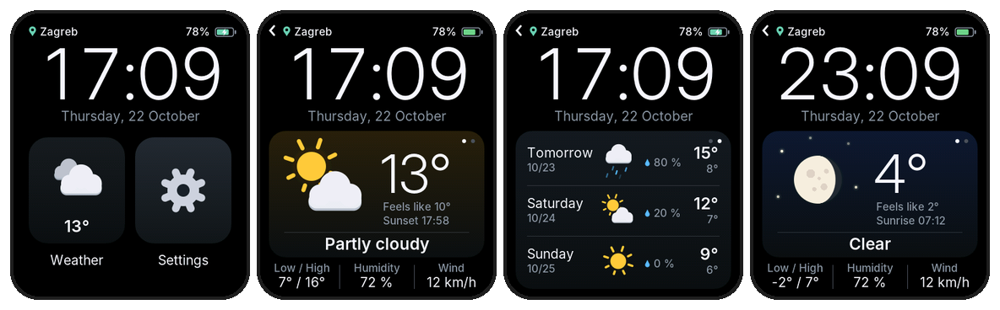
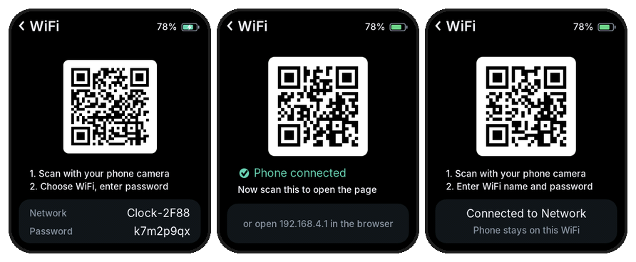
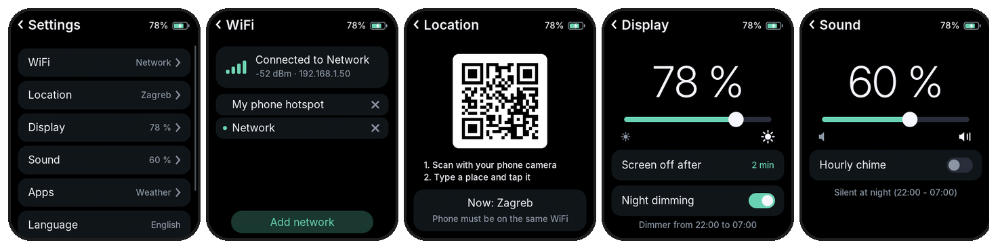
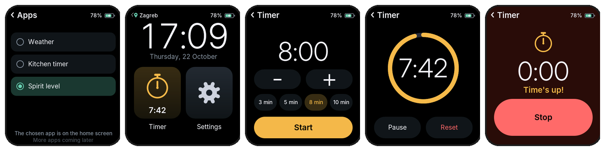
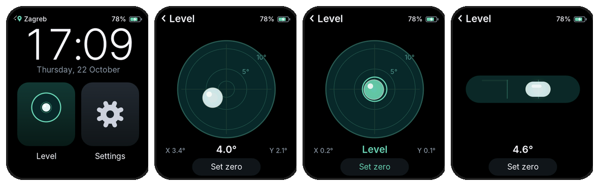

# Waveshare AMOLED sat s vremenskom prognozom

[English](README.md) · **Hrvatski**

Sat i vremenska stanica za **Waveshare ESP32-S3-Touch-AMOLED-1.8**: veliki
sat, trenutno vrijeme s animiranim ikonama, prognoza za 3 dana i postavke koje
mijenjaš s mobitela skeniranjem QR koda. Bez API ključeva i bez aplikacije za
instalirati.

**Isprobano na ploči V2** (ekran CO5300). Za originalnu ploču V1 (ekran
SH8601) postoji posebno okruženje za prevođenje, ali još nije isprobano; vidi
[Verzije ploče](#verzije-ploče).

Sustav je zadano na engleskom; u postavkama se prebacuje na hrvatski (vidi
[Jezik](#jezik)). Nazivi na ekranu ovdje su napisani na oba jezika, npr.
**Settings (Postavke)**.



## Mogućnosti

- **Sat** s datumom, sinkroniziran preko interneta; vremenska zona i
  ljetno/zimsko vrijeme prepoznaju se automatski
- **Trenutno vrijeme** za bilo koje mjesto na svijetu: temperatura, osjećaj,
  min/max, vlaga, vjetar, izlazak/zalazak sunca ([Open-Meteo](https://open-meteo.com))
- **Animirane ikone**: kiša pada, snijeg lebdi, sunce se okreće, munje
  bljeskaju; noću Mjesec pokazuje stvarnu mijenu
- **Prognoza za 3 dana**: povuci ulijevo na ekranu s vremenom
- **Ekran na dodir**: početni ekran s pločicama, povlačenje udesno = natrag
- **Postavke**: WiFi i mjesto s mobitela preko QR koda, klizači za svjetlinu i
  glasnoću, vrijeme gašenja ekrana, noćno zatamnjenje, zvono svaki sat, jezik,
  isključivanje
- **Aplikacije** za početni ekran (**Postavke → Aplikacije**): **Kuhinjski
  tajmer** (veliko odbrojavanje, zvoni kao stari mehanički tajmer) i **Libela** (libela s
  mjehurićem preko senzora pokreta)
- **Zvuk**: zvono svaki sat po želji (zadano isključeno, noću tiho)
- **Jezici**: engleski (zadano) i hrvatski, na satu i na stranicama na mobitelu
- **Baterija**: postotak i oznaka punjenja; tamniji ekran noću (može se
  isključiti)
- **Gašenje ekrana**: nakon 1, 2 ili 5 minuta (ili nikad); pali se dodirom ili
  kad podigneš sat. Dok je ekran ugašen, čip drijema, a WiFi se pali samo za
  osvježavanje: oko 13-14 sati na bateriji od 200 mAh
- **Zaštita baterije**: na USB-u punjenje staje na 100 % i kreće opet na 90 %

## Što ti treba

- **Waveshare ESP32-S3-Touch-AMOLED-1.8**. Pogledaj naljepnicu na poleđini:
  ploče s oznakom **V2** (ekran CO5300) su zadane. Starije ploče bez V2 imaju
  ekran SH8601 (vidi [Verzije ploče](#verzije-ploče)).
- **USB-C kabel koji prenosi podatke** (neki kabeli služe samo za punjenje).
- Po želji: **Li-Po baterija 3,7 V s utikačem MX1.25** (2 pina; Waveshare
  prodaje odgovarajuću). Prije spajanja provjeri da crvena žica ide na `+` na
  konektoru `BAT`.
- Računalo (Windows, macOS ili Linux) i mobitel.

## 1. Instaliraj alate (jednom)

1. **VS Code**: preuzmi i instaliraj s
   [code.visualstudio.com](https://code.visualstudio.com).
2. **Dodatak PlatformIO** (prevodi program i prebacuje ga na ploču):
   1. Otvori VS Code.
   2. Klikni ikonu **Extensions** u lijevoj traci (četiri kvadratića) ili
      pritisni `Ctrl+Shift+X` (`Cmd+Shift+X` na Macu).
   3. Potraži **PlatformIO IDE** i klikni **Install**.
   4. Pričekaj da završi (prvi put preuzima alate, par minuta), pa ponovno
      pokreni VS Code ako traži. Kad je spreman, u lijevoj traci pojavi se
      **ikona mrava**.
3. **Git** (za preuzimanje koda): instaliraj s
   [git-scm.com](https://git-scm.com). Možeš ga preskočiti i na GitHub
   stranici koristiti **Code → Download ZIP**.

## 2. Preuzmi kod

U VS Codeu otvori terminal (**Terminal → New Terminal**), idi u mapu gdje
držiš projekte i pokreni:

```
git clone https://github.com/memoo911/waveshare-weather.git
cd waveshare-weather
git config core.hooksPath .githooks
```

Zadnji red uključuje provjeru koja te sprječava da slučajno pošalješ na
GitHub datoteku sa svojom WiFi lozinkom.

Zatim **File → Open Folder…**, odaberi mapu `waveshare-weather` i klikni
**Select Folder**. Pričekaj par sekundi da se PlatformIO učita: u plavoj traci
na dnu pojave se gumbi **✓** (Build) i **→** (Upload).

## 3. Prebaci program na ploču

1. Spoji ploču s računalom USB-C kabelom.
2. **Upali ploču**: pritisni tipku **PWR** jednom. Računalo je vidi samo dok je
   upaljena (na Windowsima kao COM port).
3. U plavoj traci na dnu provjeri da piše **`env:waveshare-v2`** (klikni na
   to za promjenu).
4. Klikni **→ Upload** u plavoj traci ili pritisni `Ctrl+Alt+U`.
5. Prvi put traje nekoliko minuta (preuzimaju se biblioteke). Završi s
   **SUCCESS** i ploča se pokrene s novim programom.

**Ako se upload ne može spojiti** (`Failed to connect`, nema porta): drži
**BOOT**, pritisni **PWR** jednom, pusti **BOOT** i ponovi upload. Nakon toga
pritisni **PWR** (ili izvuci i vrati kabel) za normalno pokretanje.

**Da vidiš što ploča radi**, klikni **ikonu utikača** u plavoj traci (Serial
Monitor) ili pritisni `Ctrl+Alt+S`.

## Ažuriranje na novu verziju

Kad na GitHubu ima novog koda:

1. U VS Codeu otvori terminal (**Terminal → New Terminal**) u mapi
   `waveshare-weather` i pokreni:
   ```
   git pull
   ```
2. Upali ploču (**PWR**) i spoji je USB-C kabelom.
3. Pritisni `Ctrl+Alt+U` (Windows) ili klikni **→ Upload** u plavoj traci.
4. Pričekaj **SUCCESS**; ploča se pokrene s novom verzijom. Spremljene mreže,
   mjesto, svjetlina, zvuk i jezik ostaju kakvi su bili.

## 4. Prvo pokretanje

Na ekranu je početni ekran. Dodirni **Settings (Postavke)** za podešavanje.

### Postavke ukratko

Popis se pomiče: povuci ga prema gore da vidiš redove na dnu.

| Red | Čemu služi |
|---|---|
| **WiFi** | Spremljene mreže, dodavanje i brisanje (vidi niže) |
| **Location (Mjesto)** | Mjesto za prognozu, bira se na mobitelu |
| **Display (Zaslon)** | Svjetlina, kad se ekran gasi, noćno zatamnjenje |
| **Sound (Zvuk)** | Glasnoća, zvono svaki sat |
| **Apps (Aplikacije)** | Bira aplikaciju na početnom ekranu: Vrijeme, Kuhinjski tajmer ili Libela |
| **Language (Jezik)** | Engleski / hrvatski, dodir mijenja |
| **Turn off (Isključi)** | Gasi ploču (pali se tipkom **PWR**) |

Natrag: povuci udesno ili dodirni **‹** gore lijevo.

### Jezik

Zasad su dostupna dva jezika: **engleski** (zadano) i **hrvatski**. Za
promjenu otvori **Settings** i dodirni red **Language**; ponovni dodir vraća
natrag. Izbor se pamti i vrijedi i za stranice za postavljanje na mobitelu.
Novi jezici mogu se dodati u `src/I18n.h`.

### Spajanje na WiFi

Ploča treba **2,4 GHz** WiFi mrežu (većina rutera je ima; mreže samo na
5 GHz ne rade). Za hotspot mobitela: na iPhoneu uključi **Maksimiziraj
kompatibilnost**, na Androidu odaberi pojas **2,4 GHz**.



1. Na ploči otvori **Postavke → WiFi → Dodaj mrežu**.
2. Pojavi se QR kod (lijeva slika). **Skeniraj ga kamerom mobitela** i
   prihvati spajanje na mrežu **Clock-XXXX**. Ako mobitel upozori da mreža
   nema interneta, odaberi da **ostane spojen**.
3. Čim se mobitel spoji, ploča pokaže **drugi QR kod** (srednja slika).
   **Skeniraj ga** da se otvori stranica za postavljanje. (Neki mobiteli je
   otvore sami; možeš i upisati `192.168.4.1` u preglednik.)
4. Upiši **naziv mreže** (ili dodirni jednu od mreža u blizini) i **lozinku**,
   pa dodirni **Spremi**.
5. Ploča zatvori svoju mrežu i spoji se. Mobitel se vrati na svoj uobičajeni
   WiFi.

**Dodavanje još mreža kasnije** (npr. hotspot mobitela): kad je ploča već
spojena, **Dodaj mrežu** pokaže QR kod s adresom ploče (desna slika). Mobitel
ostaje na istom WiFi-ju, pa možeš dodati i mrežu koja trenutno nije upaljena,
poput hotspota mobitela koji držiš. Ploča se spaja na onu spremljenu mrežu koja
je u dometu.

**Brisanje mreže**: na stranici **WiFi** dodirni **×** pored nje, pa još
jednom **×** za potvrdu. Zelena točka označava mrežu koja se koristi.

### Odabir mjesta za prognozu



1. Na ploči otvori **Postavke → Mjesto**. Pojavi se QR kod.
2. Provjeri da je mobitel na **istom WiFi-ju** kao ploča, pa ga skeniraj.
3. Na stranici koja se otvori upiši grad ili selo (npr. *Zagreb*) i dodirni
   **Traži**.
4. Dodirni pravi rezultat (ispod imena piše regija i država).
5. Ploča spremi mjesto i za par sekundi pokaže njegovu prognozu.

Sat i dalje pokazuje **tvoje** lokalno vrijeme, bez obzira za koje je mjesto
prognoza.

### Zvuk

Otvori **Postavke → Zvuk**.

- **Glasnoća**: povuci klizač (0 % je tiho). Kad pustiš prst, čuje se kratki
  ton da znaš koliko je glasno. Na dodir ploča ne pušta zvukove.
- **Zvono svaki sat**: dodirni bilo gdje ispod klizača (red **Zvono svaki
  sat**) za uključivanje ili isključivanje. Prekidač je zelen kad je uključeno.
  Na svaki puni sat odsvira kratki "ding-dong", i kad je ekran ugašen, ali od
  22:00 do 07:00 je tiho. Isključeno je dok ga ne uključiš.

### Ekran i baterija

- **Noćno zatamnjenje**: od 22:00 do 07:00 ekran svijetli najviše oko 20 %,
  bez obzira na klizač, da ne osvjetljava mračnu sobu. Zadano je uključeno;
  isključuje se u **Postavke → Zaslon → Noćno zatamnjenje**.
- Ekran se gasi nakon **2 minute** bez dodira. Za promjenu otvori **Postavke →
  Zaslon** i dodirni red **Gašenje ekrana**: redom mijenja **1 min**,
  **2 min**, **5 min** i **Nikad**.
- Ekran se pali **dodirom**, tipkom **BOOT** ili kad **podigneš sat**. Dodir
  koji ga upali ne otvara ništa. Podizanje radi samo ako se ekran ugasio sam:
  nakon pritiska na **PWR** ostaje ugašen dok ga ne dodirneš ili ne pritisneš
  tipku.
- Dok je na ekranu QR kod za WiFi ili mjesto, ekran se ne gasi.
- **Štednja dok je ekran ugašen**: procesor uspori, a WiFi se gasi između
  osvježavanja prognoze svakih 15 minuta (spoji se na par sekundi, osvježi i
  opet ugasi). Kad se ekran upali, WiFi se spoji za par sekundi. Na bateriji
  čip između provjera i drijema (light sleep), a dodir ili BOOT ga odmah
  probude. Zvono svaki sat i paljenje dodirom ili podizanjem i dalje rade. Na
  USB-u ne drijema, da Serial Monitor ostane spojen.
- **Trajanje baterije** (baterija 200 mAh, izmjereno): s ugašenim ekranom
  traje oko **13-14 sati** (oko 7 % na sat); s upaljenim ekranom puno kraće.
  Isključena (**Postavke → Isključi**) ne troši ništa.
- **Prazna baterija**: na bateriji se ploča sama ugasi na 3 %, da se Li-Po
  nikad ne isprazni do kraja. Napuni je i pritisni **PWR**.
- **Zaštita baterije**: dok je ploča na USB-u, punjenje staje na 100 % i
  ponovno kreće tek kad baterija padne na 90 %. U međuvremenu ploča radi s
  USB-a, pa munjica pored baterije može nedostajati iako je kabel spojen. Tako
  se baterija ne troši kad sat stalno stoji na kabelu.

### Isključivanje

Pomakni **Postavke** do dna i dodirni **Isključi**. Pojavi se stranica s
velikim crvenim gumbom **Isključi**; dodir na njega potpuno gasi ploču, i kad
je na USB-u. **Odustani** (ili povlačenje udesno) vraća natrag. Ponovno se pali
jednim pritiskom na **PWR**; sve postavke ostaju. Držanje **PWR** 6 sekundi
također gasi ploču.

### Aplikacije



**Postavke → Aplikacije** bira aplikaciju koja je na početnom ekranu uz
Postavke: **Vrijeme** (zadano), **Kuhinjski tajmer** ili **Libela**. Dodirni jednu;
zelena točka pokazuje odabranu. Za povratak prognoze ponovno odaberi Vrijeme.
Stići će još aplikacija.

**Kuhinjski tajmer** (dodirni njegovu pločicu na početnom ekranu):

1. Postavi vrijeme s **−** i **+** (minuta po dodiru, do 99) ili dodirni
   **3 / 5 / 8 / 10 min**. Zadnje korišteno vrijeme se pamti.
2. Dodirni **Kreni**. Krug odbrojava, a pločica na početnom ekranu pokazuje
   preostalo vrijeme.
3. **Pauza** / **Nastavi**, ili **Poništi** za prekid.
4. Na **0:00** ekran se upali i ploča zvoni kao staro zvonce kuhinjskog
   tajmera **10 sekundi**,
   barem upola glasno (i kad je glasnoća 0 %) i noću. Dodir bilo gdje ili
   tipka **BOOT** ranije ga zaustavlja.

Odbrojavanje radi i kad odeš na druge stranice ili se ekran ugasi. Dok je
odbrojavanje na ekranu, ekran se ne gasi.

**Libela** (dodirni njezinu pločicu na početnom ekranu):



- **Kad leži ravno**: okrugla libela. Mjehurić ide prema višoj strani; ispod
  piše ukupni nagib te nagib lijevo/desno (**X**) i naprijed/natrag (**Y**).
  Ispod 0,5° mjehurić pozeleni i piše **Ravno**.
- **Kad stoji na rubu**: prebaci se na libelu s cijevi uz donji rub (ili
  okomito kad stoji na bočnom rubu), s kutom ispod.
- **Nula**: stavi ploču na površinu za koju znaš da je ravna i dodirni;
  taj položaj se od tada računa kao 0° (pamti se). Svaki način (ravno, donji
  rub, bočni rub) ima svoju nulu.
- Dok je libela otvorena, ekran se ne gasi.

Ako se mjehurić miče na krivu stranu, okreni ili zamijeni osi s
`LEVEL_FLIP_X`, `LEVEL_FLIP_Y` i `LEVEL_SWAP_XY` u `src/Config.h`.

## Svakodnevno korištenje

| Radnja | Što radi |
|---|---|
| Dodir pločice na početnom ekranu | Otvara odabranu aplikaciju (Vrijeme, Kuhinjski tajmer ili Libela) ili Postavke |
| Povlačenje **ulijevo** na ekranu s vremenom | Prognoza za 3 dana |
| Povlačenje **udesno** ili **‹** gore lijevo | Natrag |
| **Postavke → Zaslon** | Klizač za svjetlinu; **Gašenje ekrana** bira kad se ekran gasi; **Noćno zatamnjenje** pali/gasi tamniji ekran noću (22:00 do 07:00) |
| **Postavke → Aplikacije** | Vrijeme, Kuhinjski tajmer ili Libela na početnom ekranu |
| **Postavke → Zvuk** | Klizač za glasnoću (kratki ton kad pustiš prst); dodir ispod njega pali/gasi zvono svaki sat |
| Tipka **BOOT** | Osvježi prognozu odmah (gore piše "Osvježavam…"); pali ugašen ekran; zaustavlja zvono tajmera |
| Dodir tamnog ekrana ili podizanje sata | Pali ekran |
| **PWR**, kratko | Ekran gasi / pali |
| Povlačenje gore / dolje u **Postavkama** | Pomiče popis (dolje su Aplikacije, Jezik, Isključi) |
| **Postavke → Isključi** | Potvrda: crveni gumb **Isključi** potpuno gasi ploču, i na USB-u (**Odustani** vraća). Pali se tipkom **PWR** |
| **PWR**, drži 6 sekundi | Gasi ploču (jedan pritisak je pali) |

Prognoza se osvježava svakih 15 minuta. Postavke, spremljene mreže i mjesto
ostaju i kad se ploča ugasi.

## Rješavanje problema

| Problem | Pokušaj ovo |
|---|---|
| `UnknownBoard` ili greške pri prevođenju nakon ažuriranja | Povuci najnoviji kod (`git pull`); projekt sam određuje verzije biblioteka |
| Računalo ne vidi ploču | Upali je tipkom **PWR**; probaj drugi USB-C kabel (mora prenositi podatke) |
| "Ne vidim mrežu *mreža*" | Mreža nije u dometu ili je samo 5 GHz; koristi 2,4 GHz mrežu |
| "Kriva lozinka za *mreža*?" | Obriši je na stranici WiFi i dodaj ponovno |
| Nema zvuka | Provjeri **Postavke → Zvuk**: glasnoća iznad 0 %. Zvono je zadano isključeno i noću (22:00 do 07:00) tiho |
| Na USB-u je, a nema munjice | Normalno zbog zaštite baterije: punjenje opet kreće na 90 % |
| Ekran se pali sam od sebe ili se ne pali kad podigneš sat | Promijeni `LIFT_TILT_DEG` / `LIFT_JOLT_G` u `src/Config.h` (veće = manje osjetljivo) ili stavi **Gašenje ekrana → Nikad** |
| Ploča se sama ugasila | Baterija je pala na 3 % dok nije bila na USB-u. Napuni je i pritisni **PWR** |
| Ekran se nikad ne gasi | **Postavke → Zaslon → Gašenje ekrana** je na **Nikad**, ili je otvorena stranica s QR kodom za WiFi / mjesto |
| Stranica za postavljanje se ne otvara na mobitelu | Skeniraj drugi QR kod ili otvori `192.168.4.1` u pregledniku. Na Samsung mobitelima pomaže da na trenutak isključiš **Postavke → Veze → Više postavki veze → Privatni DNS** |
| Stranica za mjesto se ne učitava | Mobitel i ploča moraju biti na istom WiFi-ju |

## Verzije ploče

Postoje dva ekrana. U plavoj traci odaberi odgovarajuće okruženje:

- **`waveshare-v2`**: ploče V2 (naljepnica V2, ekran CO5300). Zadano.
- **`waveshare-v1`**: originalne ploče (ekran SH8601). Treba noviju Arduino
  jezgru od one koju standardno daje PlatformIO i nije isprobano.

## Podešavanje u kodu

Zadane vrijednosti su u `src/Config.h`: početno mjesto, jezik i vremenska zona
(dok ih ne promijeniš na ploči), intervali osvježavanja, noćni sati, granice
svjetline, zadana glasnoća i vrijeme gašenja ekrana, osjetljivost paljenja
podizanjem (`LIFT_TILT_DEG`, `LIFT_JOLT_G`), zaštita baterije
(`BATTERY_CARE`, `BATTERY_FULL_PERCENT`, `BATTERY_RESUME_PERCENT`), razina
za gašenje kod prazne baterije (`BATTERY_SHUTDOWN_PERCENT`) i štednja
(`CPU_MHZ_SCREEN_OFF`, `LIGHT_SLEEP`). Svakih 10 minuta Serial Monitor ispiše red `[Power]`
s postotkom i naponom baterije, da se vidi koliko traje.

`src/credentials.h` **nije obavezan**. Ako radije upisuješ WiFi mreže u kod,
kopiraj `src/credentials.h.example` u `src/credentials.h` i popuni ga. Mreže se
jednom kopiraju u memoriju ploče; nakon toga njima upravljaš na uređaju kao i
ostalima. `credentials.h` je u `.gitignore`, a i provjera prije commita ga
blokira.

## Privatnost

- WiFi lozinke spremljene su samo na ploči (i u `credentials.h` ako ga
  koristiš, a on nikad ne napušta tvoje računalo).
- Ploča se spaja na: [Open-Meteo](https://open-meteo.com) s koordinatama
  odabranog mjesta, [ip-api.com](https://ip-api.com) da prema javnoj IP adresi
  odredi vremensku zonu, i NTP poslužitelje za točno vrijeme.
- Stranica za mjesto i stranica za postavljanje WiFi-ja rade samo dok su te
  stranice otvorene na ploči.

## Razvoj

Kod, komentari i poruke u gitu su na engleskom. Detalji o alatima (pregled
ekrana na računalu, generiranje fontova, raspored koda) su u
[README.md](README.md#development), a plan u `ROADMAP.md`.

## Zasluge i licenca

Kod je pod [MIT licencom](LICENSE). Dijelovi drugih autora zadržavaju svoje
licence: font Inter (SIL Open Font License 1.1,
[licenses/Inter-OFL.txt](licenses/Inter-OFL.txt)), biblioteka za QR kodove
(MIT, Project Nayuki) i upravljački program za ES8311 (Apache 2.0, Espressif).
Open-Meteo i ip-api.com besplatni su za nekomercijalnu upotrebu. Ostale
korištene biblioteke: GFX Library for Arduino, XPowersLib, ArduinoJson. Popis s
poveznicama je u [README.md](README.md#credits).
