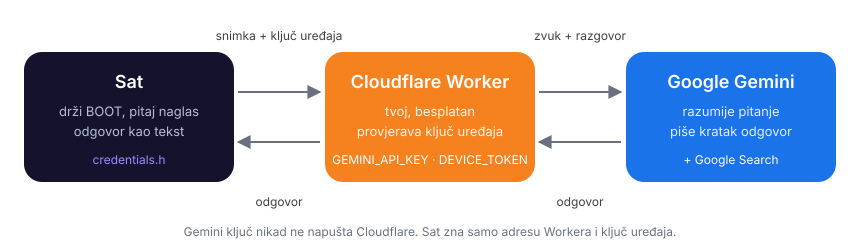

# AI Assistant: postavljanje korak po korak

[English](AI-ASSISTANT.md) · **Hrvatski** · [Natrag na README](../README.hr.md)

Aplikacija **AI Assistant**: držiš gornju tipku (**BOOT**), postaviš pitanje
naglas i pročitaš odgovor na ekranu. Odgovara na jeziku na kojem pitaš, u
nekoliko kratkih rečenica, a kad pitanje traži svježe podatke (utakmice,
vijesti, radno vrijeme, cijene) sam pretraži Google.


## Kako radi



- Sat snimi pitanje i pošalje ga na **tvoj mali poslužitelj**, besplatni
  **Cloudflare Worker**.
- Worker doda tvoj **Gemini API ključ**, pita Google Gemini i vrati odgovor
  satu.
- Sat zna samo **dvije stvari**: adresu Workera i **ključ uređaja** (dugu
  lozinku koju znaju samo tvoj sat i tvoj Worker).

> [!IMPORTANT]
> **Ključevi nikad ne idu na GitHub.** Gemini API ključ je spremljen samo u
> Cloudflareu kao *tajna* (secret). Adresa Workera i ključ uređaja upisuju se
> samo u tvoj lokalni `src/credentials.h`, koji git ignorira (naveden je u
> `.gitignore`, a i provjera prije commita u `.githooks` ga blokira). U ovom
> repozitoriju nema ničijih ključeva, adresa ni osobnih podataka, i ništa iz
> ovih uputa to ne mijenja. Ključeve ne lijepi u issue, slike ekrana ni
> razgovore.

## Što ti treba

- Projekt otvoren u **VS Codeu** s **PlatformIO** (kao u glavnom README-u), a
  sat već radi na tvom WiFi-ju
- **Google račun** (za Gemini API ključ)
- Besplatan **Cloudflare račun**
- **Node.js** (LTS verzija) na računalu
- Petnaestak minuta

**Cijena:** Cloudflare Workers je za ovo besplatan. Gemini se plaća po
korištenju: vrlo malo po pitanju, a pitanja za koja pretražuje Google koštaju
malo više nakon mjesečnog besplatnog dijela. Trenutne cijene i ograničenja:
Google AI Studio → **Billing**.

---

## 1. korak: provjeri Node.js

1. U VS Codeu otvori terminal: **Terminal → New Terminal**.
2. Upiši:
   ```
   node -v
   ```
3. Ako ispiše verziju (npr. `v22.11.0`), idi na 2. korak.
4. Ako piše da naredba ne postoji:
   1. Otvori [nodejs.org](https://nodejs.org) i preuzmi verziju **LTS**.
   2. Instaliraj je sa zadanim opcijama.
   3. **Zatvori i ponovno otvori VS Code**, pa opet upiši `node -v`.

## 2. korak: napravi Gemini API ključ

1. Otvori [Google AI Studio → API keys](https://aistudio.google.com/apikey) i
   prijavi se Google računom.
2. Klikni **Create API key**. Ako pita za projekt, odaberi onaj na kojem je
   plaćanje / kredit.
3. Kopiraj ključ (počinje s `AIza…`).
4. **Spremi ga negdje privatno** (upravitelj lozinki ili privatna bilješka).
   Zalijepit ćeš ga u Cloudflare u 7. koraku.

> [!WARNING]
> Gemini ključ čuvaj kao lozinku: tko ga ima, može trošiti tvoj kredit.
> Nikad ga ne upisuj u datoteku u projektu i nikad ga ne commitaj.

## 3. korak: Cloudflare račun

1. Otvori [dash.cloudflare.com](https://dash.cloudflare.com).
2. Prijavi se, ili klikni **Sign up**, upiši email i lozinku i potvrdi email.
   Kartica nije potrebna; besplatni paket je zadan.

## 4. korak: prijava u Cloudflare iz VS Codea

1. U VS Code terminalu, u mapi projekta, uđi u mapu `worker`:
   ```
   cd worker
   ```
2. Prijavi se:
   ```
   npx wrangler login
   ```
3. Prvi put pita `Need to install the following packages: wrangler…
   Ok to proceed? (y)`: upiši **y** i pritisni **Enter**.
4. Otvori se preglednik s Cloudflareom: klikni **Allow**.
5. U terminalu piše **Successfully logged in**.

> [!TIP]
> Ako PowerShell javi *"running scripts is disabled on this system"*, jednom
> pokreni ovo, potvrdi s **Y** i ponovi naredbu:
> ```
> Set-ExecutionPolicy -Scope CurrentUser RemoteSigned
> ```
> Ako se preglednik ne otvori, kopiraj link iz terminala u preglednik.

## 5. korak: postavi Worker na internet

1. I dalje u mapi `worker`:
   ```
   npx wrangler deploy
   ```
2. Ako pita za **workers.dev poddomenu** (samo prvi put na računu), upiši
   kratko ime. Ono postaje dio javne adrese, pa nemoj upisivati puno ime i
   prezime.
3. Na kraju ispiše adresu Workera:
   ```
   https://clock-assistant.<tvoja-poddomena>.workers.dev
   ```
   **Kopiraj je i spremi** uz Gemini ključ.
4. Provjera: otvori tu adresu u pregledniku. Mora pisati:
   ```
   {"ok":true,"service":"clock assistant"}
   ```

### Gdje kasnije pronaći adresu Workera

- **U terminalu**: pomakni se gore do ispisa `npx wrangler deploy`; redak
  koji počinje s `https://clock-assistant.` je adresa.
- **Na Cloudflareu**:
  1. Otvori [dash.cloudflare.com](https://dash.cloudflare.com).
  2. U izborniku lijevo: **Compute (Workers)** → **Workers & Pages**.
  3. Klikni **clock-assistant**.
  4. Pod **Domains & Routes** (ili **Settings → Domains & Routes**) redak
     **Production** pokazuje `clock-assistant.<tvoja-poddomena>.workers.dev`.
  5. Poddomena tvog računa piše i na stranici **Workers & Pages**, desno,
     kao **Subdomain**.

> [!NOTE]
> Cloudflare piše *"Anyone with this URL can visit"*. To je u redu: bez
> ključa uređaja Worker odgovara samo "unauthorized". **Nemoj** klikati
> **Enable Access**: tražio bi prijavu u Cloudflare i blokirao i sat.

## 6. korak: napravi ključ uređaja

Ključ uređaja je duga nasumična lozinka koju dijele tvoj sat i tvoj Worker.

1. U VS Code terminalu (PowerShell) pokreni:
   ```
   [guid]::NewGuid().ToString("N") + [guid]::NewGuid().ToString("N")
   ```
   Na macOS-u ili Linuxu: `openssl rand -hex 32`.
2. Ispiše 64 nasumična slova i broja. **Kopiraj ih i spremi privatno**, uz
   Gemini ključ i adresu Workera. Isti ključ trebaš dvaput: u Workeru (7.
   korak) i na satu (8. korak). Ako ga izgubiš, samo napravi novi i upiši ga
   ponovno na oba mjesta.

## 7. korak: spremi oba ključa u Worker (kao tajne)

I dalje u mapi `worker`:

1. Ključ uređaja:
   ```
   npx wrangler secret put DEVICE_TOKEN
   ```
   Kad pita `Enter a secret value`, zalijepi ključ iz 6. koraka (desni klik u
   terminalu) i pritisni **Enter**. Tekst se ne vidi dok lijepiš; to je
   normalno. Piše **Success! Uploaded secret DEVICE_TOKEN**.
2. Gemini ključ:
   ```
   npx wrangler secret put GEMINI_API_KEY
   ```
   Zalijepi ključ iz 2. koraka, pritisni **Enter**, pričekaj **Success!**.
3. Provjeri da su oba tu (ispisuje samo imena, nikad vrijednosti):
   ```
   npx wrangler secret list
   ```
   Moraju biti `DEVICE_TOKEN` i `GEMINI_API_KEY`.

Tajne su spremljene samo u Cloudflareu. Nisu ni u jednoj datoteci, ni na satu,
ni u gitu.

## 8. korak: upiši adresu i ključ u sat

1. Vrati se u mapu projekta:
   ```
   cd ..
   ```
2. Ako još nemaš `src/credentials.h`, napravi ga iz primjera:
   ```
   Copy-Item src\credentials.h.example src\credentials.h
   ```
   (ili u VS Code Exploreru: desni klik na `credentials.h.example` → **Copy**,
   desni klik na `src` → **Paste**, pa kopiju preimenuj u `credentials.h`).
3. Otvori `src/credentials.h` i popuni dva retka na dnu: adresu iz 5. koraka
   **s `/ask` na kraju** i ključ uređaja iz 6. koraka:
   ```cpp
   #define ASSISTANT_URL "https://clock-assistant.<tvoja-poddomena>.workers.dev/ask"
   #define ASSISTANT_TOKEN "<tvoj ključ uređaja>"
   ```
   Ako tvoja datoteka nema te retke (napravljena je prije AI Assistanta),
   dodaj ih na kraj. Ako postoje s praznim navodnicima, samo ih popuni;
   nemoj ih dodavati dvaput.
4. WiFi u istoj datoteci nije obavezan. Ostavi `{"", ""},` kako jest ako WiFi
   postavljaš s mobitela. Mreža upisana ovdje kopira se na sat samo jednom, s
   pravom lozinkom.
5. Spremi (**Ctrl+S**).
6. Provjeri da git ignorira datoteku:
   ```
   git check-ignore -v src/credentials.h
   ```
   Mora ispisati `.gitignore:2:src/credentials.h  src/credentials.h`. A
   `git status` **ne smije** prikazati `credentials.h`.

## 9. korak: prebaci na sat

1. Upali sat (**PWR**) i spoji ga USB-C kabelom.
2. Pritisni **Ctrl+Alt+U** (ili **→ Upload** u plavoj traci dolje).
3. Pričekaj **SUCCESS**.

## 10. korak: probaj

1. Na satu: **Postavke → Aplikacije → AI Assistant**. Na početnom ekranu se
   pojavi robot.
2. Dodirni robota.
3. **Drži gornju tipku (BOOT)**, pitaj npr. *"Koliko je sati?"* ili *"Kada je
   sljedeće finale Lige prvaka?"* i pusti tipku.
4. Nekoliko sekundi piše "Razmišljam…", a onda dođe odgovor.
5. Za nastavak opet drži BOOT; **Novi razgovor** pri dnu kreće ispočetka.

---

## Kasnije promjene

- **Kraći / duži odgovori, ton, pravila**: uredi `SYSTEM_PROMPT` u
  `worker/src/index.js`.
- **Gemini model**: promijeni `GEMINI_MODEL` u `worker/wrangler.toml` (npr.
  jeftiniji `flash-lite` model).
- Zatim u mapi `worker`: `npx wrangler deploy`. **Upload na sat nije
  potreban.**
- **Log Workera uživo** (korisno kad nešto ne radi): u mapi `worker` pokreni
  `npx wrangler tail`, pa postavi pitanje na satu.
- **Novi Gemini ključ ili ključ uređaja**: ponovno pokreni isti `npx wrangler
  secret put …` (a za ključ uređaja i promijeni `credentials.h` i napravi
  upload).

## Rješavanje problema

| Na satu | Što napraviti |
|---|---|
| **Još nije postavljen** | `ASSISTANT_URL` ili `ASSISTANT_TOKEN` je prazan u `src/credentials.h`, ili nisi napravio upload nakon upisa (8. i 9. korak). |
| **Worker je odbio ključ uređaja** | Ključ u `credentials.h` nije isti kao `DEVICE_TOKEN` u Workeru. Upiši ga ponovno (7. korak, točka 1) ili ispravi `credentials.h`, pa upload. |
| **Nešto nije u redu (502)** | Gemini je odbio: kriv ili nepostojeći `GEMINI_API_KEY`, nema kredita, ili model ne postoji. Pokreni `npx wrangler tail` i pitaj ponovno da vidiš poruku Geminija. |
| **Nešto nije u redu (0)** ili **(-1)** | Sat ne može doći do Workera: provjeri adresu u `credentials.h` (treba `https://` i `/ask`) i WiFi. |
| **Nema WiFi veze** | Sat nije spojen; provjeri **Postavke → WiFi**. |
| **Nisam te razumio** | Nije čuo ništa korisno: govori malo glasnije i bliže, nakon što mikrofon zasvijetli. |
| **Drži tipku dok govoriš** | Pritisak je bio prekratak: drži BOOT cijelo vrijeme dok govoriš. |

Serial Monitor za svako pitanje ispiše retke `[Audio] recorded … ms` i
`[Assistant] HTTP …`. U njima nema ključeva, ali iza HTTP retka može doći
poruka o grešci: pogledaj je prije nego je nekome pošalješ.

## Privatnost

- Sat snima samo dok držiš BOOT na stranici AI Assistanta.
- Snimka, dosadašnji razgovor, lokalno vrijeme sata i mjesto prognoze idu na
  tvoj Worker i odatle u Google Gemini (tamo vrijede Googleovi uvjeti za
  Gemini API). Worker ništa ne sprema; sat pamti razgovor samo do **Novog
  razgovora** ili izlaska sa stranice.
- Veza sa sata je HTTPS s provjerom certifikata.
