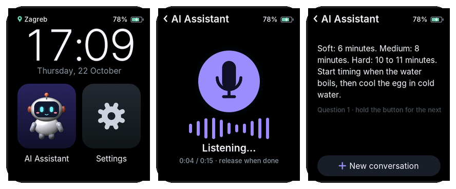
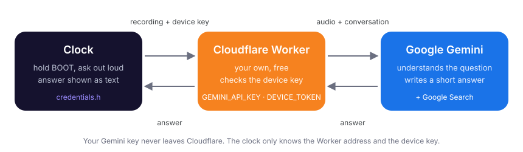

# AI Assistant: setup, step by step

**English** · [Hrvatski](AI-ASSISTANT.hr.md) · [Back to the README](../README.md)

The **AI Assistant** app lets you hold the top button (**BOOT**), ask a
question out loud and read the answer on the screen. It answers in the
language you ask in, in a few short sentences, and searches Google by itself
when the question needs current information (match dates, news, opening
hours, prices).



## How it works



- The clock records your question and sends it to **your own small server**,
  a free **Cloudflare Worker**.
- The Worker adds your **Gemini API key**, asks Google Gemini and sends the
  answer back to the clock.
- The clock only knows **two things**: the Worker's address and a **device
  key** (a long password that only your clock and your Worker know).

> [!IMPORTANT]
> **Keys never go on GitHub.** The Gemini API key is stored only in
> Cloudflare as a *secret*. The Worker address and the device key go only in
> your local `src/credentials.h`, which git ignores (it's in `.gitignore`,
> and the commit check in `.githooks` blocks it). Nothing in this repository
> contains anyone's keys, addresses or personal data, and nothing you do in
> this guide changes that. Don't paste keys into issues, screenshots or chats.

## What you need

- The project open in **VS Code** with **PlatformIO** (as in the main README),
  and the clock already working on your WiFi
- A **Google account** (for the Gemini API key)
- A free **Cloudflare account**
- **Node.js** (LTS version) on your computer
- About 15 minutes

**Cost:** Cloudflare Workers is free for this. Gemini is billed per use: very
little per question; questions where it searches Google cost a bit more after
a monthly free allowance. Current prices and limits: Google AI Studio →
**Billing**.

---

## Step 1: Check Node.js

1. In VS Code open a terminal: **Terminal → New Terminal**.
2. Type:
   ```
   node -v
   ```
3. If it prints a version (for example `v22.11.0`), go to step 2.
4. If it says the command isn't found:
   1. Open [nodejs.org](https://nodejs.org) and download the **LTS** version.
   2. Install it with the default options.
   3. **Close and reopen VS Code**, then run `node -v` again.

## Step 2: Create the Gemini API key

1. Open [Google AI Studio → API keys](https://aistudio.google.com/apikey) and
   sign in with your Google account.
2. Click **Create API key**. If it asks for a project, pick the one that has
   billing / credit on it.
3. Copy the key (it starts with `AIza…`).
4. **Save it somewhere private** (a password manager or a private note). You
   will paste it into Cloudflare in step 7.

> [!WARNING]
> Treat the Gemini key like a password: anyone who has it can use your
> credit. Never put it in a file in the project, never commit it.

## Step 3: Cloudflare account

1. Open [dash.cloudflare.com](https://dash.cloudflare.com).
2. Log in, or click **Sign up**, enter an email and password and confirm the
   email. No card is needed; the free plan is the default.

## Step 4: Log in to Cloudflare from VS Code

1. In the VS Code terminal, in the project folder, go into the `worker`
   folder:
   ```
   cd worker
   ```
2. Log in:
   ```
   npx wrangler login
   ```
3. The first time it asks `Need to install the following packages: wrangler…
   Ok to proceed? (y)`: type **y** and press **Enter**.
4. A browser opens on Cloudflare: click **Allow**.
5. The terminal says **Successfully logged in**.

> [!TIP]
> If PowerShell says *"running scripts is disabled on this system"*, run this
> once, answer **Y**, and repeat the command:
> ```
> Set-ExecutionPolicy -Scope CurrentUser RemoteSigned
> ```
> If the browser doesn't open, copy the link shown in the terminal into your
> browser.

## Step 5: Put the Worker online

1. Still in the `worker` folder:
   ```
   npx wrangler deploy
   ```
2. If it asks for a **workers.dev subdomain** (only the very first time on an
   account), type a short name. It becomes part of a public address, so
   don't use your full name.
3. At the end it prints the Worker's address:
   ```
   https://clock-assistant.<your-subdomain>.workers.dev
   ```
   **Copy it and save it** next to the Gemini key.
4. Check it: open that address in a browser. It must show:
   ```
   {"ok":true,"service":"clock assistant"}
   ```

### Where to find the Worker address later

- **In the terminal**: scroll up to the output of `npx wrangler deploy`; the
  line starting with `https://clock-assistant.` is the address.
- **On Cloudflare**:
  1. Open [dash.cloudflare.com](https://dash.cloudflare.com).
  2. In the menu on the left: **Compute (Workers)** → **Workers & Pages**.
  3. Click **clock-assistant**.
  4. Under **Domains & Routes** (or **Settings → Domains & Routes**) the
     **Production** line shows `clock-assistant.<your-subdomain>.workers.dev`.
  5. Your account's subdomain is also shown on the **Workers & Pages** page,
     on the right, as **Subdomain**.

> [!NOTE]
> Cloudflare says *"Anyone with this URL can visit"*. That's fine: without
> the device key the Worker only answers "unauthorized". **Don't** click
> **Enable Access**: it would ask for a Cloudflare login and block the clock
> as well.

## Step 6: Make the device key

The device key is a long random password shared by your clock and your
Worker.

1. In the VS Code terminal (PowerShell) run:
   ```
   [guid]::NewGuid().ToString("N") + [guid]::NewGuid().ToString("N")
   ```
   On macOS or Linux: `openssl rand -hex 32`.
2. It prints 64 random letters and digits. **Copy them and save them
   privately**, next to the Gemini key and the Worker address. You need the
   same key twice: in the Worker (step 7) and on the clock (step 8). If you
   lose it, just make a new one and set it in both places again.

## Step 7: Store both keys in the Worker (as secrets)

Still in the `worker` folder:

1. The device key:
   ```
   npx wrangler secret put DEVICE_TOKEN
   ```
   When it asks `Enter a secret value`, paste the key from step 6 (right
   click in the terminal) and press **Enter**. The text doesn't show while you
   paste; that's normal. It says **Success! Uploaded secret DEVICE_TOKEN**.
2. The Gemini key:
   ```
   npx wrangler secret put GEMINI_API_KEY
   ```
   Paste the key from step 2, press **Enter**, wait for **Success!**.
3. Check that both are there (it lists only the names, never the values):
   ```
   npx wrangler secret list
   ```
   You should see `DEVICE_TOKEN` and `GEMINI_API_KEY`.

Secrets live only in Cloudflare. They are not in any file, not on the clock
and not in git.

## Step 8: Tell the clock the address and the key

1. Go back to the project folder:
   ```
   cd ..
   ```
2. If you don't have `src/credentials.h` yet, make it from the example:
   ```
   Copy-Item src\credentials.h.example src\credentials.h
   ```
   (or in the VS Code Explorer: right click `credentials.h.example` → **Copy**,
   right click `src` → **Paste**, then rename the copy to `credentials.h`).
3. Open `src/credentials.h` and fill in the two lines at the bottom: the
   address from step 5 **with `/ask` at the end**, and the device key from
   step 6:
   ```cpp
   #define ASSISTANT_URL "https://clock-assistant.<your-subdomain>.workers.dev/ask"
   #define ASSISTANT_TOKEN "<your device key>"
   ```
   If your file has no such lines (it was made before the AI Assistant),
   add them at the end. If they're there with empty quotes, fill them in;
   don't add them twice.
4. WiFi in the same file is optional. Leave `{"", ""},` as it is if you set up
   WiFi from your phone. A network listed here is copied to the clock only
   once, with its real password.
5. Save (**Ctrl+S**).
6. Check that git ignores the file:
   ```
   git check-ignore -v src/credentials.h
   ```
   It must print `.gitignore:2:src/credentials.h  src/credentials.h`. And
   `git status` must **not** list `credentials.h`.

## Step 9: Upload to the clock

1. Turn the clock on (**PWR**) and connect it with the USB-C cable.
2. Press **Ctrl+Alt+U** (or **→ Upload** in the blue bar at the bottom).
3. Wait for **SUCCESS**.

## Step 10: Try it

1. On the clock: **Settings → Apps → AI Assistant**. The robot appears on the
   home screen.
2. Tap the robot.
3. **Hold the top button (BOOT)**, ask for example *"What time is it?"* or
   *"When is the next Champions League final?"*, and let go.
4. "Thinking…" shows for a few seconds, then the answer.
5. Hold BOOT again for a follow-up; **New conversation** at the bottom starts
   over.

---

## Changing it later

- **Shorter / longer answers, tone, rules**: edit `SYSTEM_PROMPT` in
  `worker/src/index.js`.
- **Gemini model**: change `GEMINI_MODEL` in `worker/wrangler.toml` (for
  example a cheaper `flash-lite` model).
- Then, in the `worker` folder: `npx wrangler deploy`. **No upload to the
  clock is needed.**
- **Live log** of the Worker (handy when something goes wrong): in the
  `worker` folder run `npx wrangler tail`, then ask a question on the clock.
- **New Gemini key or device key**: run the same `npx wrangler secret put …`
  again (and for the device key also update `credentials.h` and upload).

## Troubleshooting

| On the clock | What to do |
|---|---|
| **Not set up yet** | `ASSISTANT_URL` or `ASSISTANT_TOKEN` is empty in `src/credentials.h`, or you didn't upload after filling them in (step 8 and 9). |
| **The Worker rejected the device key** | The key in `credentials.h` isn't the same as `DEVICE_TOKEN` in the Worker. Set it again (step 7.1) or fix `credentials.h`, then upload. |
| **Something went wrong (502)** | Gemini refused: wrong or missing `GEMINI_API_KEY`, no credit/billing, or a model name that doesn't exist. Run `npx wrangler tail` and ask again to see Gemini's message. |
| **Something went wrong (0)** or **(-1)** | The clock couldn't reach the Worker: check the address in `credentials.h` (it needs `https://` and `/ask`), and the WiFi. |
| **No WiFi connection** | The clock isn't connected; check **Settings → WiFi**. |
| **I didn't catch that** | It heard nothing useful: speak a little louder, closer, after the microphone lights up. |
| **Hold the button while you speak** | The press was too short: hold BOOT the whole time you speak. |

The serial monitor shows `[Audio] recorded … ms` and `[Assistant] HTTP …`
lines for each question. They contain no keys, but the HTTP line can be
followed by an error message: check it before sharing.

## Privacy

- The clock records only while you hold BOOT on the AI Assistant page.
- The recording, the conversation so far, the clock's local time and the
  forecast place go to your Worker and from there to Google Gemini (Google's
  Gemini API terms apply there). The Worker stores nothing; the clock keeps
  the conversation only until **New conversation** or leaving the page.
- The connection from the clock is HTTPS with the certificate checked.
